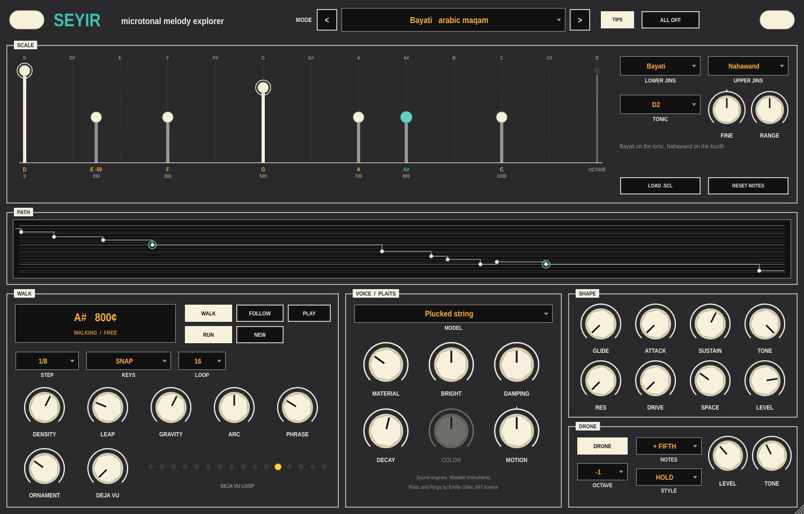

# Seyir

A microtonal melody explorer for Ableton Live. Pick a maqam, a raga or any
tuning, and Seyir improvises a melody in it over a drone, the way a player
moves through a mode: mostly by step, leaning on the strong notes, ending
phrases on a resting note, and climbing away from the tonic over several
phrases before coming back. That path is what *seyir* means in maqam music.

It makes its own sound with Mutable Instruments' Plaits and Rings, so the
microtones need no setup: load it on a MIDI track and press play.



## What's on the panel

**MODE** (header) — click for the list, or step with `<` `>`. Changing mode keeps
the tonic, so you can hear one mode after another over the same drone.

- **Arabic maqam**: Rast, Bayati, Hijaz, Saba, Sikah, Huzam, Nahawand, Kurd, Ajam,
  Nikriz. Quarter-tone spelling (150, 350 cents and so on).
- **Turkish makam**: Rast, Uşşak, Hüseyni, Hicaz, Kürdi, Nihavend, in commas of
  1/53 octave. Compare Turkish and Arabic Rast to hear how different their
  thirds are.
- **Hindustani raga**: Yaman, Bhupali, Bhairav, Bhimpalasi, Malkauns, Todi,
  Marwa, Bhairavi, in just intonation, with their own notes going up and coming
  down and their vadi and samvadi as the strong notes.
- **Gamelan & more**: Slendro, Pelog (one typical tuning each; every gamelan
  differs), Thai 7-equal.
- **Just & equal**: harmonics 8–16, just major, 12-TET major for comparison,
  24-EDO, Bohlen-Pierce.
- **Scala files**: LOAD .SCL reads any `.scl` file, including ones whose period
  isn't an octave. The huygens-fokker.org archive has thousands.

**SCALE**
- The ladder shows one octave of the scale against the piano's twelve notes
  (dashed). Each note shows its nearest piano note and offset (`E -50`) and
  its cents above the tonic.
- Click a note to hear it. Drag it up or down to change how strongly the melody
  is drawn to it; all the way down takes it out of the scale. Shift-drag sideways
  to retune it. Double-click undoes. RESET NOTES undoes everything.
- Arrows mark notes used only going up or only coming down (Rast's B half-flat
  up and B-flat down; Yaman's Pa only on the way down).
- A ring marks a resting note: phrases like to end there.
- **LOWER JINS / UPPER JINS** (maqams only): a maqam is two cells, one on the
  tonic and one on the ghammaz. Swap the upper one to modulate. Both are host
  parameters, so a modulation can be automated.
- **TONIC**, **FINE** (cents), **RANGE** (how high the melody climbs).

**PATH** — the melody over the last 14 seconds against the scale. Rings mark
phrase ends; amber notes were replayed from the DEJA VU loop.

**WALK**
- **WALK**: walks while Live plays, locked to its grid. **RUN** walks without
  Live's transport, at Live's tempo.
- **FOLLOW**: hold a key and a phrase starts on that note and keeps going until
  you let go.
- **PLAY**: your keys play the scale. KEYS = SNAP plays the nearest scale note to
  the key you press (play D E F and hear D, E half-flat, F). KEYS = WHITE KEYS
  makes C3 the tonic and each white key the next note.
- **DENSITY** busier or sparser. **LEAP** how far one move can jump.
  **GRAVITY** pull of the strong notes. **ARC** how clearly phrases climb and
  return. **PHRASE** notes per phrase. **ORNAMENT** chance of a slide, a grace
  note from above, or a shake.
- **DEJA VU** (the idea is from Marbles): how often a step is replayed from the
  loop instead of invented. All the way up locks it (LEDs turn red). Lock a
  phrase, then swap the upper jins to hear the same melody in another maqam.
  **NEW** forgets the loop. **STEP** and **LOOP** set the step length and the
  loop length.

**VOICE** — the melody's sound. MODEL picks one of Plaits' engines (plucked
string, modal, analog, FM, six-op FM, formant, additive, wavetable, speech and
more) or one of Rings' resonators (modal, sympathetic strings, inharmonic
string, FM). A, B and C are the model's own three knobs and are named for
it. DECAY is how long notes ring. COLOR is Plaits' low-pass gate, MOTION lets
each note's envelope move B.

**SHAPE** — GLIDE, ATTACK, SUSTAIN, a low-pass filter (TONE, RES), DRIVE,
SPACE (Rings' reverb, on melody and drone) and LEVEL.

**DRONE** — the tonic with a pure fifth, fourth or octave. HOLD is a steady
additive drone; PLUCK strikes strings in a tanpura's cycle, one per beat. It
sounds while the melody plays and for a few seconds after you touch a key or
the ladder.

## Building

Needs CMake 3.22+ and a C++20 compiler. JUCE 8.0.9 is downloaded on first
configure.

```sh
cmake -B build -DCMAKE_BUILD_TYPE=Release
cmake --build build --config Release
ctest --test-dir build -C Release
```

The VST3 is copied to `~/Library/Audio/Plug-Ins/VST3` after each build on macOS
(`-DSEYIR_COPY_PLUGIN=OFF` to stop that). `-DSEYIR_BUILD_TOOLS=ON` also builds
`SeyirSnapshot`, which runs Seyir without a host and writes the panel to a PNG
and what it played to a WAV.

The engine tests check the scales, the walker and the synth's tuning (within
2 cents at 44.1, 48 and 96 kHz).

## Credits and licence

The sound engines are Émilie Gillet's Plaits and Rings from Mutable
Instruments, under the MIT licence. See [THIRD_PARTY.md](THIRD_PARTY.md).
Seyir isn't affiliated with Mutable Instruments.

Seyir is released under the GNU AGPLv3. See [LICENSE](LICENSE).
